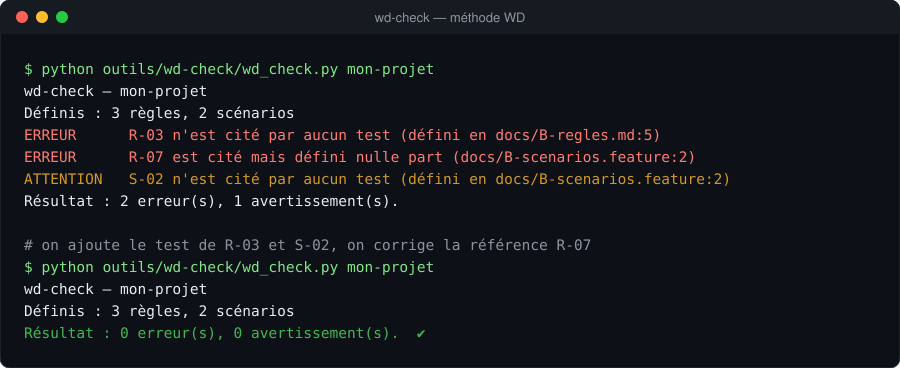
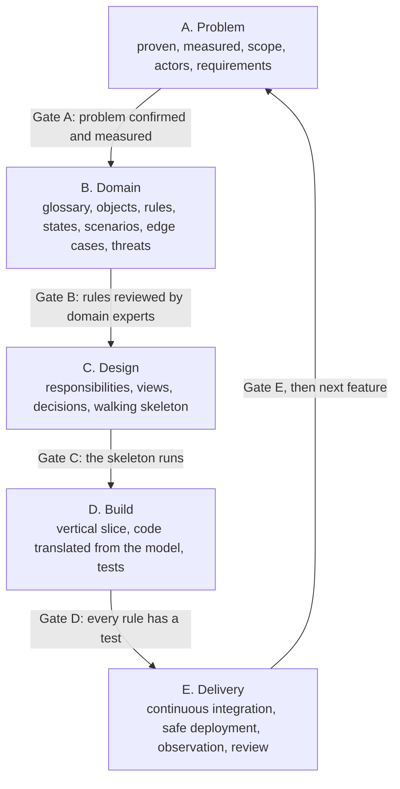

# WD Method

[](https://github.com/wd-a11y/wd/actions/workflows/verification.yml)
[](LICENSE)
[](LICENSE-docs.md)

[Français](README.md) · **English**

**A complete, verifiable software design method — from the real problem to tested, shipped code.**

The WD Method applies to any software engineering project: web or mobile app, API, internal tool, data platform, embedded software. It does not depend on a language, a framework or a business domain.

Its core idea: **code is not invented while you type it; it translates an analysis that was already done** — and every step of that analysis leaves a written trace that can be checked.

> **Language note:** the method pages, templates and examples are written in French. This page summarises everything in English; a full English translation is on the roadmap. The `wd-check` tool works on documents in any language.



*`wd-check` reads the project's documents and tests: here it reports a business rule that no test proves, and a scenario that cites a rule that does not exist.*

---

## The method at a glance



Five phases, each closed by a **gate**: a checklist that must be fully ticked before moving on. A failed gate sends you back to the previous phase. After delivery, each new feature runs through the cycle again in a short form.

## Quick start

1. **Pick your project level**: [S, M or L](methode/niveaux-S-M-L.md) (small script, real application, critical system). It tells you which steps are mandatory.
2. **Copy the templates** into your project:
   ```bash
   cp -r gabarit/docs my-project/docs
   ```
3. **Follow the phases in order**, starting from [methode/00-principes.md](methode/00-principes.md). Each step fits on one page: questions to ask, deliverable, exit criterion.
4. **Check traceability** at any time:
   ```bash
   python outils/wd-check/wd_check.py my-project
   ```
5. **With an AI coding agent** (Claude Code or similar): install the [skill/methode-wd](skill/methode-wd/SKILL.md) skill. The agent runs the phases with you, fills in the deliverables and refuses to write production code before gate C.

## What is in the repository

| Folder | Content |
| --- | --- |
| `methode/` | The method: 29 one-page steps across 5 phases, one gate per phase, project levels, 17 common pitfalls |
| `gabarit/docs/` | Eleven empty deliverables to copy into any project |
| `exemples/` | The method applied to three very different projects (see below) |
| `outils/wd-check/` | Traceability checker — a single Python file, no dependencies |
| `skill/methode-wd/` | Skill for AI coding agents |
| `.github/` | Issue and pull request templates, continuous integration |

| Example | Kind of software | Level | Covers |
| --- | --- | --- | --- |
| [gestion-stock](exemples/gestion-stock/) | Inventory management | M | Phases A–D, Python code and 21 tests, including concurrent withdrawals and a 2,000-run property test |
| [api-reservation](exemples/api-reservation/) | Seat-booking web API | M | Phases A–C, 6-state lifecycle, double booking under load, API threats |
| [thermostat-embarque](exemples/thermostat-embarque/) | Embedded heating controller | L | Phases A–C, real-time and safety rules, sensor failures, three independent safety barriers |

## Traceable identifiers

| Prefix | Means | Example |
| --- | --- | --- |
| `B-` | Need / success measure | B-01 Average handling time halved |
| `F-` | Feature | F-03 Cancel a booking |
| `H-` | Hypothesis to verify | H-02 Technicians have mobile coverage on site |
| `R-` | Business rule | R-01 Stock never goes negative |
| `S-` | Scenario | S-04 Two customers book the same seat at the same time |
| `T-` | Test | T-07 Fifty parallel requests, only one succeeds |
| `D-` | Architecture decision | D-01 Relational database rather than document store |
| `M-` | Threat | M-02 A user reads someone else's record |

An identifier is **defined** once (in `docs/`) and **cited** everywhere else: scenarios, tests, code, commits. `wd-check` verifies those links and fails the build when a rule has no test.

## The seven principles

1. **One step, one deliverable.** Thinking that is not written down does not exist.
2. **One phase, one gate.** Move on only when the checklist is ticked.
3. **Everything is identified and linked.** A test cites the rule it proves; a rule cites the need it serves.
4. **Hypotheses are visible.** Every assumption is written down, then confirmed or dropped.
5. **Risk decides the order.** Tackle first what could sink the whole project.
6. **Iterate in small loops.** Documents are living, never frozen.
7. **Size the effort.** Every step has a time box and a depth level.

## Roadmap

- [x] **v2.0** — the method, templates, three examples, AI skill, minimal `wd-check` ([changelog](CHANGELOG.md))
- [ ] Full English translation of the method pages
- [ ] Domain description in schema-validated YAML, read by `wd-check`
- [ ] Test skeleton generation from rules and scenarios
- [ ] A `.wd` specification language and editor extension (only if the YAML version proves useful to others)

## Where it comes from

The WD Method does not invent new concepts. It assembles recognised practices into one teachable, checkable path:

- Domain-Driven Design (Eric Evans, 2003);
- Behaviour-Driven Development and Given / When / Then scenarios (Dan North, 2006);
- Event Storming (Alberto Brandolini);
- the C4 model for architecture views (Simon Brown);
- Architecture Decision Records (Michael Nygard, 2011);
- the STRIDE threat model.

What it adds: a single path from the problem all the way to production, explicit gates, and traceability a machine can verify.

## Contributing

See [CONTRIBUTING.md](CONTRIBUTING.md) (in French). Issues and pull requests in English are welcome.

## License

- Method texts, templates and examples: [CC BY-SA 4.0](LICENSE-docs.md).
- Code (`outils/`, example code): [MIT](LICENSE).
