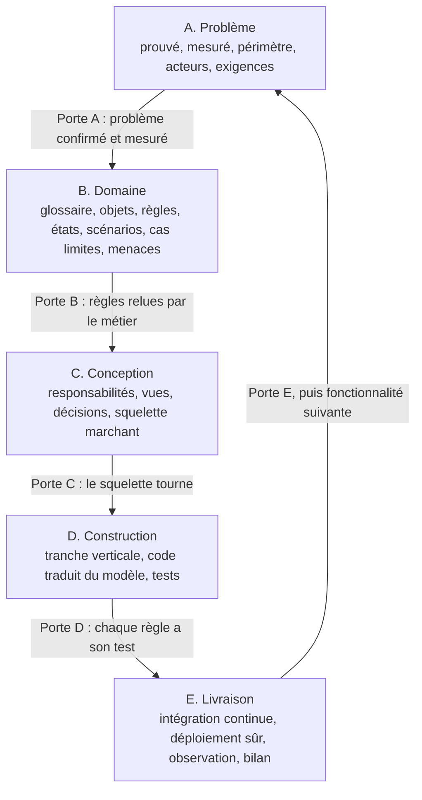

# Méthode WD

[](https://github.com/wd-a11y/wd/actions/workflows/verification.yml)
[](LICENSE)
[](LICENSE-docs.md)

**Français** · [English](README.en.md)

**Une méthode complète et vérifiable de conception logicielle, du problème réel au code testé et livré.**

La méthode WD s'applique à tout projet d'ingénierie logicielle : application web ou mobile, API, outil interne, plateforme de données, logiciel embarqué. Elle ne dépend ni d'un langage, ni d'un framework, ni d'un domaine métier.

Son idée centrale : **le code n'est pas inventé au moment de l'écrire, il traduit une analyse déjà faite** — et chaque étape de cette analyse laisse une trace écrite qu'on peut vérifier.


*`wd-check` relit les documents et les tests du projet : il signale ici une règle qu'aucun test ne prouve et un scénario qui cite une règle inexistante.*

---

## La méthode en une image



Cinq phases, une **porte** de contrôle après chacune. Une porte qui échoue renvoie à la phase précédente. Après la livraison, chaque nouvelle fonctionnalité reprend le cycle en version courte.

## Démarrage en 5 minutes

1. **Choisis le niveau** de ton projet : [S, M ou L](methode/niveaux-S-M-L.md). Il dit quelles étapes sont obligatoires.
2. **Copie le gabarit** dans ton projet :
   ```bash
   cp -r gabarit/docs mon-projet/docs
   ```
3. **Suis les phases dans l'ordre**, en partant de [methode/00-principes.md](methode/00-principes.md). Chaque étape tient sur une page : questions à poser, livrable, critère de sortie.
4. **Vérifie la traçabilité** à tout moment :
   ```bash
   python outils/wd-check/wd_check.py mon-projet
   ```
   L'outil signale par exemple « R-09 n'a aucun test » ou « S-04 cite une règle qui n'existe pas ».
5. **Avec un agent IA** (Claude Code ou autre) : installe la skill [skill/methode-wd](skill/methode-wd/SKILL.md). L'agent conduit les phases, remplit les livrables avec toi et refuse de coder avant la porte C.

## Ce que contient le dépôt

```text
wd/
├── methode/              la méthode : une page par étape, une porte par phase
│   ├── 00-principes.md
│   ├── A-probleme/       étapes 1 à 4b
│   ├── B-domaine/        étapes 5 à 13b
│   ├── C-conception/     étapes 14 à 17
│   ├── D-construction/   étapes 18 à 20
│   ├── E-livraison/      E1 à E4 et étape 21
│   ├── niveaux-S-M-L.md
│   └── pieges.md
├── gabarit/docs/         les livrables vides, à copier dans n'importe quel projet
├── exemples/             la méthode appliquée à trois projets très différents
│   ├── gestion-stock/        logiciel de gestion, niveau M, complet jusqu'au code testé
│   ├── api-reservation/      service web, niveau M, phases A à C
│   └── thermostat-embarque/  logiciel embarqué critique, niveau L, phases A à C
├── skill/methode-wd/     skill pour agent IA
├── outils/wd-check/      vérificateur de traçabilité (Python, sans dépendance)
└── .github/              modèles d'issue et de pull request, intégration continue
```

## Les sept principes

1. **Une étape = un livrable.** Une réflexion qui n'est pas écrite n'existe pas.
2. **Une phase = une porte.** On avance seulement quand la liste de contrôle est cochée.
3. **Tout est identifié et relié.** Un test cite la règle qu'il prouve ; une règle cite le besoin qui la justifie.
4. **Les hypothèses sont visibles.** Ce qu'on suppose est noté, puis confirmé ou abandonné.
5. **Le risque décide de l'ordre.** On traite d'abord ce qui peut faire échouer tout le projet.
6. **Itérer en petites boucles.** Les documents sont vivants, jamais figés.
7. **Proportionner l'effort.** Chaque étape a une durée maximale et un niveau de profondeur.

Détails : [methode/00-principes.md](methode/00-principes.md).

## Les identifiants

| Préfixe | Désigne | Exemple |
| --- | --- | --- |
| `B-` | Besoin ou mesure de réussite | B-01 Délai moyen de traitement divisé par 2 |
| `F-` | Fonctionnalité | F-03 Annuler une réservation |
| `H-` | Hypothèse à vérifier | H-02 Les techniciens ont du réseau sur site |
| `R-` | Règle métier | R-01 Le stock ne devient jamais négatif |
| `S-` | Scénario | S-04 Deux clients réservent le même siège en même temps |
| `T-` | Test | T-07 Cinquante requêtes parallèles, une seule réussit |
| `D-` | Décision d'architecture | D-01 Base de données relationnelle plutôt que documentaire |
| `M-` | Menace | M-02 Un utilisateur lit le dossier d'un autre |

Un identifiant est **défini** une seule fois (dans `docs/`) et **cité** partout ailleurs : scénarios, tests, code, commits. C'est ce lien que vérifie `wd-check`.

## Feuille de route

- [x] **v2.0** — la méthode, le gabarit, trois exemples, la skill IA, `wd-check` minimal ([journal des versions](CHANGELOG.md))
- [ ] Description du domaine en YAML validé par schéma, lue par `wd-check`
- [ ] Génération de squelettes de tests à partir des règles et des scénarios
- [ ] Langage de spécification `.wd` et extension d'éditeur (seulement si la version YAML sert à d'autres)

## D'où vient la méthode

La méthode WD n'invente pas de concept nouveau. Elle assemble, dans un ordre pédagogique et vérifiable, des pratiques reconnues :

- conception pilotée par le domaine (Eric Evans, *Domain-Driven Design*, 2003) ;
- développement piloté par le comportement et scénarios Soit / Quand / Alors (Dan North, 2006) ;
- atelier Event Storming (Alberto Brandolini) ;
- modèle C4 pour les vues d'architecture (Simon Brown) ;
- décisions d'architecture écrites, ou ADR (Michael Nygard, 2011) ;
- modèle de menaces STRIDE.

Sa valeur propre : un parcours unique du problème jusqu'à la production, des portes de contrôle explicites, et une traçabilité qu'une machine peut vérifier.

## Contribuer

Voir [CONTRIBUTING.md](CONTRIBUTING.md).

## Licence

- Textes de la méthode, gabarits et exemples : [CC BY-SA 4.0](LICENSE-docs.md).
- Code (`outils/`, code des exemples) : [MIT](LICENSE).
