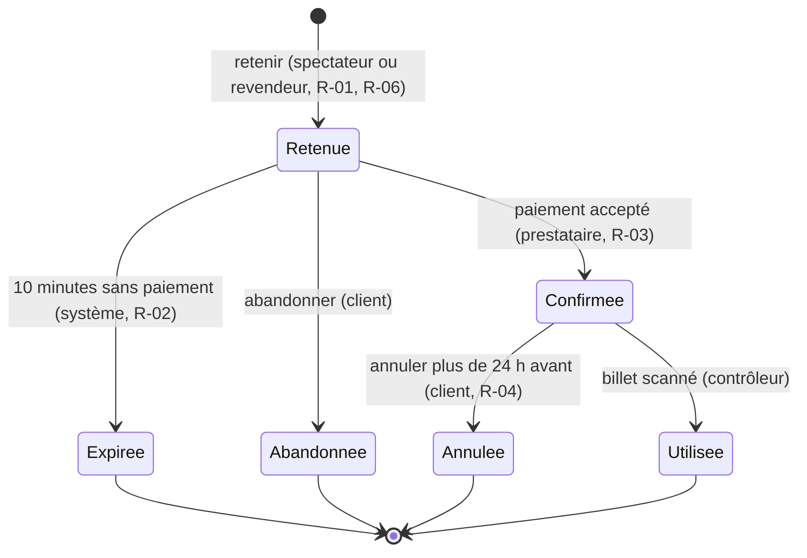

# Modèle du domaine

## Glossaire

| Terme | Définition | Type |
| --- | --- | --- |
| Séance | Une représentation d'un spectacle, dans une salle, à une date et une heure | Entité |
| Place | Un siège numéroté d'une salle, pour une séance | Entité, dans l'agrégat Séance |
| Réservation | Engagement d'un client sur une ou plusieurs places d'une séance | Entité, racine d'agrégat |
| Retenue | Réservation pas encore payée, qui bloque les places pendant un temps limité | État d'une réservation |
| Clé d'idempotence | Code fourni par l'appelant pour qu'une requête répétée ne soit traitée qu'une fois | Objet-valeur |

Synonymes interdits : « ticket » (on dit « billet » pour le document, « réservation » pour l'engagement), « panier ».

## Relations

| Relation | Cardinalité | Agrégat |
| --- | --- | --- |
| Séance → Place | 1 – N | même agrégat |
| Réservation → Place | N – N, au plus une réservation active par place (R-01) | agrégats séparés ; unicité garantie par la base (D-01) |

## Cycle de vie : Réservation

Toute transition non dessinée est interdite : une réservation expirée ne peut pas être confirmée, même si le paiement arrive en retard (le paiement est alors remboursé automatiquement).

## Événements

| Événement | Réactions | Si une réaction échoue |
| --- | --- | --- |
| `PlacesRetenues` | lancer le compte à rebours de 10 min | — |
| `PaiementAccepte` | confirmer, envoyer le billet | billet renvoyé toutes les 5 min, 6 fois |
| `PaiementArriveApresExpiration` | rembourser, prévenir le client | alerte à l'équipe |
| `RetenueExpiree` | libérer les places | — |
