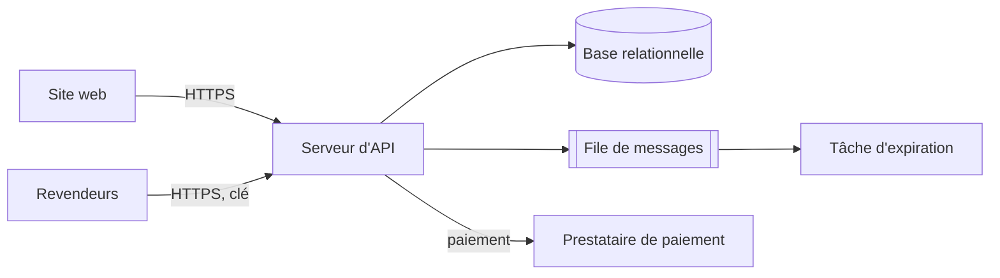

# Architecture

## Modules

| Module | Couche | Responsabilité |
| --- | --- | --- |
| `reservation.domaine` | Domaine | Garantir les états et les règles d'une réservation, et rien d'autre. |
| `reservation.application` | Application | Cas d'usage retenir, confirmer, annuler, expirer ; droits et quotas. |
| `reservation.api` | Interface | Recevoir les requêtes HTTP, valider leur format, appliquer la limite de débit. |
| `reservation.depot` | Infrastructure | Lire et écrire en base ; garantir l'unicité des places actives (D-01). |
| `reservation.paiement` | Infrastructure | Dialoguer avec le prestataire de paiement, avec délai maximal et nouvelles tentatives. |

## Vue des conteneurs

## Squelette marchant

Retenir une place sur une séance de test, la relire, déployé automatiquement ; test de charge à 2 000 requêtes par seconde sur cette seule action pour vérifier B-02 avant d'aller plus loin.

## Ordre de construction

| Tranche | Fonctionnalités | Scénarios | Règles | Raison |
| --- | --- | --- | --- | --- |
| 1 | F-01 (retenir) | S-02, S-04, S-06 | R-01, R-07 | Risque principal : double réservation sous charge |
| 2 | F-01 (payer, expirer) | S-01, S-03, S-05 | R-02, R-03 | Paiement externe incertain |
| 3 | F-03 | S-07, S-09, S-10 | R-05, R-06, R-08 | Ouverture aux revendeurs |
| 4 | F-02, F-04 | S-08 | R-04 | Moins risqué |
