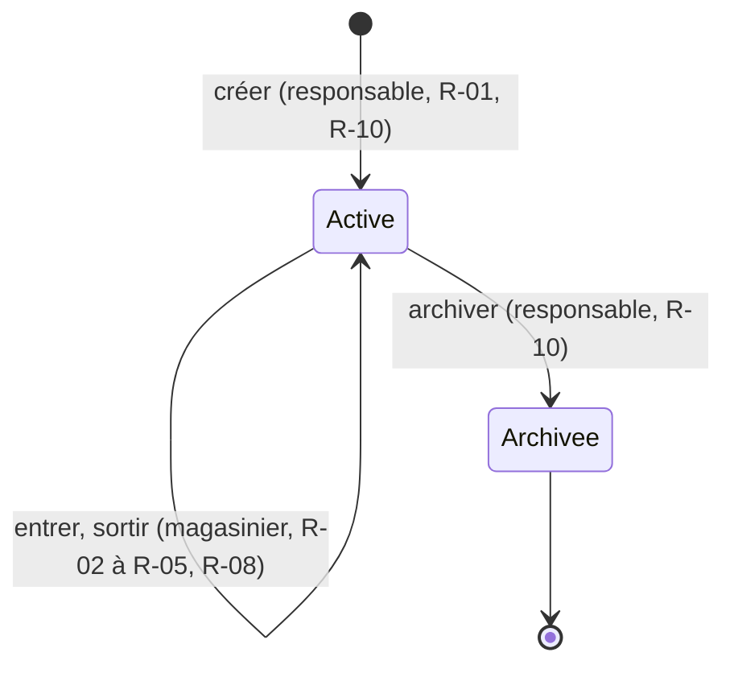

# Modèle du domaine

## Inventaire et classement

| Objet | Catégorie | Entité ou objet-valeur |
| --- | --- | --- |
| Pièce | central | entité, racine d'agrégat |
| Mouvement | événementiel | entité, dans l'agrégat Pièce |
| Quantité | secondaire | objet-valeur |
| Utilisateur (rôle) | secondaire | fourni par l'annuaire de l'atelier |

## Fiche : Pièce

- **Qui :** un article stocké au magasin.
- **Pourquoi :** savoir combien il en reste et quand commander.
- **Unique :** sa référence (R-01).
- **Droits :** créée et archivée par le responsable (R-10) ; mouvements par magasinier ou responsable (R-03).
- **Mort :** jamais supprimée, seulement archivée (R-06) ; l'historique est gardé 10 ans.

| Donnée | Type | Format | Plage | Catégorie | Source de vérité |
| --- | --- | --- | --- | --- | --- |
| reference | texte | majuscules, chiffres, tirets | 1 à 30 caractères | obligatoire | — |
| seuil_alerte | entier | pièces | 0 à 1 000 000 | facultative (défaut 0) | — |
| archivee | booléen | — | — | obligatoire (défaut non) | — |
| stock | entier | pièces | ≥ 0 | calculée | les mouvements (R-07) |

## Fiche : Mouvement

- **Unique :** son identifiant de requête (R-08).
- **Droits :** jamais modifié ni supprimé ; une erreur se corrige par un mouvement inverse (R-09).

| Donnée | Type | Format | Catégorie |
| --- | --- | --- | --- |
| id_requete | texte | fourni par la tablette | obligatoire |
| sens | énumération | entrée / sortie | obligatoire |
| quantite | Quantité | entier > 0 (R-02) | obligatoire |
| horodatage | date et heure | UTC, ISO 8601 | obligatoire |

## Relations

| Relation | Cardinalité | Si le parent disparaît | Agrégat |
| --- | --- | --- | --- |
| Pièce → Mouvement | 1 – N | impossible : une pièce n'est jamais supprimée | même agrégat : la sortie et la vérification du stock se font d'un seul coup |

## Cycle de vie : Pièce

Une pièce archivée n'accepte plus aucun mouvement (R-06).

## Événements

| Événement | Déclencheur | Données | Réactions | Si une réaction échoue |
| --- | --- | --- | --- | --- |
| `StockBas` | une sortie fait passer le stock sous le seuil (R-05) | référence, stock, seuil | prévenir le responsable et le logiciel d'achat | nouvel essai toutes les 5 min, alerte au responsable après 3 échecs |
