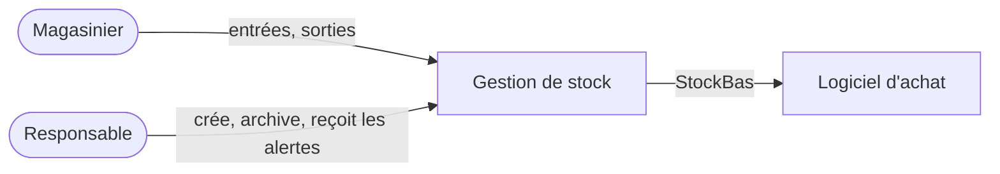

# Architecture

## Modules

| Module | Couche | Responsabilité |
| --- | --- | --- |
| `stock.domaine` | Domaine | Garantir que chaque pièce et chaque mouvement respectent les règles du stock, et rien d'autre. |
| `stock.application` | Application | Orchestrer les cas d'usage : vérifier les droits, verrouiller, appeler le domaine, enregistrer, publier les événements. |
| `stock.depot_memoire` | Infrastructure | Conserver les pièces, avec un verrou par pièce. Remplacé en production par une base relationnelle (D-01). |

Le domaine ne dépend d'aucun autre module.

## Vue de contexte

## Choix techniques

| Sujet | Choix | Décision |
| --- | --- | --- |
| Langage | Python | compétence de l'équipe |
| Stockage | Base relationnelle, verrou par pièce | D-01 |
| Heure | Toujours en UTC, affichée en heure locale | — |

## Squelette marchant

Action traversée : créer une pièce, enregistrer une entrée, relire le stock sur la tablette. Hypothèses tranchées : H-01, H-02.

## Ordre de construction

| Tranche | Fonctionnalités | Scénarios | Règles | Raison |
| --- | --- | --- | --- | --- |
| 1 | F-02, F-01 | S-01 à S-05, S-07, S-09 | R-02, R-04, R-07, R-08 | Cœur du problème, et règle la plus risquée (concurrence) |
| 2 | F-04 | S-08, S-11, S-13 | R-01, R-06, R-10 | Nécessaire avant la mise en service |
| 3 | F-03 | S-06 | R-05 | Sert B-02 |
