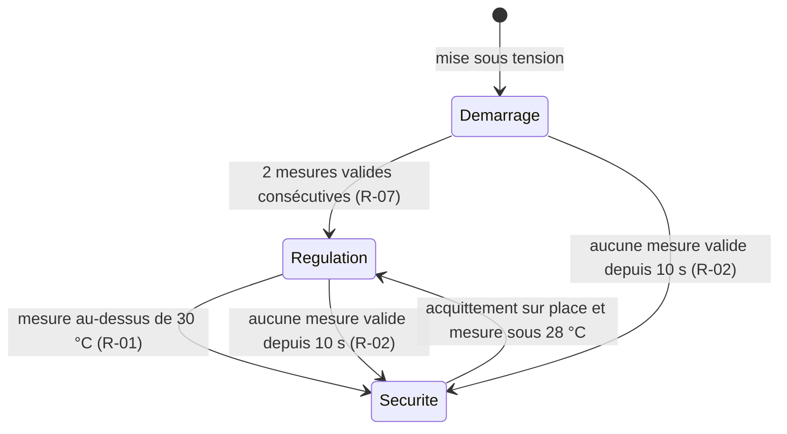

# Modèle du domaine

## Glossaire

| Terme | Définition | Type |
| --- | --- | --- |
| Mesure | Température lue par le capteur à un instant, en °C avec une décimale | Objet-valeur |
| Mesure valide | Mesure dans la plage du capteur (−40 à 85 °C), reçue depuis moins de 10 s | Calculé |
| Consigne | Température visée, entre 5 et 28 °C | Objet-valeur |
| Seuil de sécurité | 30 °C, non modifiable à distance | Constante |
| Mode | État du régulateur : Démarrage, Régulation, Sécurité | Énumération |

## Cycle de vie : modes du régulateur

En **Démarrage** et en **Sécurité**, le chauffage est toujours coupé. Un redémarrage, quel que soit le mode, ramène en Démarrage. Il n'existe aucune transition de Sécurité vers Régulation sans acquittement humain sur place.

## Événements

| Événement | Réactions |
| --- | --- |
| `SurchauffeDetectee` | couper le relais, alarme sonore, alerte sur le téléphone |
| `CapteurMuet` | couper le relais, alarme, alerte |
| `ConsigneModifiee` | journaliser l'auteur et l'ancienne valeur |
