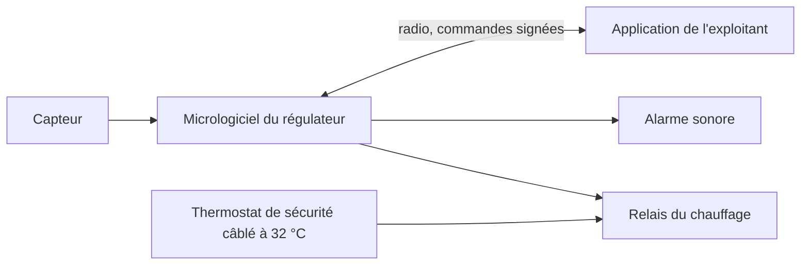

# Architecture

## Modules

| Module | Couche | Responsabilité |
| --- | --- | --- |
| `securite` | Domaine | Décider la coupure (R-01, R-02, R-07), et rien d'autre. Exécuté en priorité maximale. |
| `regulation` | Domaine | Calculer l'état voulu du chauffage autour de la consigne (R-04). |
| `commandes` | Application | Vérifier et appliquer les commandes à distance (R-05, R-06). |
| `pilotes` | Infrastructure | Lire le capteur, piloter le relais, l'alarme et la radio. |
| `journal` | Infrastructure | Écrire 30 jours d'événements en mémoire locale. |

La décision de `securite` l'emporte toujours sur celle de `regulation`.

## Vue des conteneurs

## Squelette marchant

Sur la vraie carte : lire le capteur, couper le relais au-dessus d'un seuil, mesurer le délai réel à l'oscilloscope. Hypothèse à trancher : le délai de lecture du capteur laisse-t-il assez de marge sous 2 s ?

## Ordre de construction

| Tranche | Fonctionnalités | Scénarios | Règles | Raison |
| --- | --- | --- | --- | --- |
| 1 | F-01 | S-01 à S-04 | R-01, R-02, R-03, R-07 | Sécurité physique d'abord |
| 2 | F-02 | S-05 | R-04 | Sert B-02 |
| 3 | F-03 | S-06, S-07 | R-05, R-06 | Ouverture radio, donc menaces |
| 4 | F-04 | S-08 | R-08 | Dépend de la radio |
