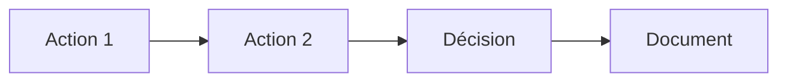
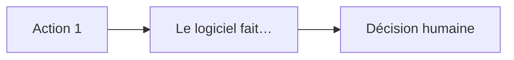

# Problème — [nom du projet]

Niveau du projet : **S / M / L** (choisir et justifier en une phrase)

## 1. Problème

> Pour [qui], qui [situation], le problème est [X]. Aujourd'hui ils font [Y], ce qui coûte [Z].

### Preuve

| Personne (rôle) | Date | Ce qu'elle a fait la dernière fois | Ce que ça lui a coûté |
| --- | --- | --- | --- |
| | | | |

### Mesures de réussite

| Id | Mesure | Valeur actuelle | Cible | Comment on la mesure |
| --- | --- | --- | --- | --- |
| B-01 | | | | |

## 2. Périmètre

### Fonctionnalités

| Id | Fonctionnalité | Besoin | Rang |
| --- | --- | --- | --- |
| F-01 | | B-01 | Indispensable / Important / Bonus / Pas maintenant |

### Ce que nous ne ferons pas

| Refus | Raison |
| --- | --- |
| | |

### Contraintes

- Délai :
- Budget :
- Compétences disponibles :
- Obligations légales :
- Matériel cible :

## 3. Acteurs

| Acteur | Type (humain, système, malveillant) | Fréquence | Compétence | Besoin principal |
| --- | --- | --- | --- | --- |
| | | | | |

### Matrice des droits

| Action | [Acteur 1] | [Acteur 2] | [Système externe] |
| --- | --- | --- | --- |
| | | | |

## 4. Processus

### Actuel (sans le logiciel)

### Futur (avec le logiciel)

### Ce qui reste humain

-

## 4b. Exigences non fonctionnelles

| Famille | Seuil | Remarque |
| --- | --- | --- |
| Performance | | |
| Volume | | |
| Disponibilité | | |
| Sécurité | | |
| Données personnelles | | |
| Accessibilité et langues | | |
| Coût | | |
| Maintenabilité | | |

## Porte A

- [ ] Le problème tient en une phrase, et au moins 5 personnes l'ont confirmé.
- [ ] Au moins une mesure `B-xx` est chiffrée.
- [ ] Les fonctionnalités sont triées ; la liste des refus existe.
- [ ] Chaque acteur a ses droits ; les systèmes externes sont listés.
- [ ] Les exigences non fonctionnelles ont des seuils.
- [ ] Les hypothèses ont une vérification et une date.
