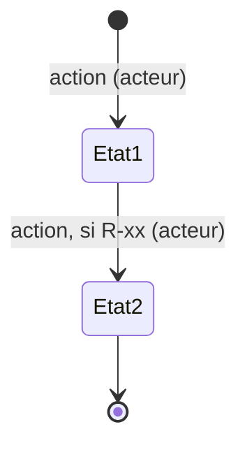

# Modèle du domaine

## Inventaire et classement (étape 5)

| Objet | Catégorie (central, secondaire, référence, événementiel, technique) | Entité ou objet-valeur |
| --- | --- | --- |
| | | |

## Fiches objets (étapes 6, 7, 8)

### [Objet]

- **Qui est-il ?**
- **Pourquoi existe-t-il ?**
- **Qu'est-ce qui le rend unique ?**
- **Qui peut le créer, le lire, le modifier, le supprimer ?**
- **Comment meurt-il ?** (suppression, archivage, anonymisation, durée de conservation)

| Donnée | Type | Unité / format | Plage | Obligatoire / facultative / calculée | Source de vérité si calculée et stockée | Historisée ? |
| --- | --- | --- | --- | --- | --- | --- |
| | | | | | | |

Comportements :

-

Règles qui le concernent : R-…

## Relations (étape 9)

| Relation | Cardinalité | Si le parent disparaît | Agrégat |
| --- | --- | --- | --- |
| | | | |

## Cycles de vie (étape 9b)

### [Objet à statut]

Toute transition non dessinée est interdite.

## Événements (étape 10)

| Événement (au passé) | Déclencheur | Données | Réactions | Si une réaction échoue |
| --- | --- | --- | --- | --- |
| | | | | |
