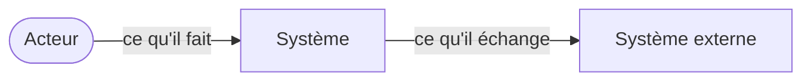
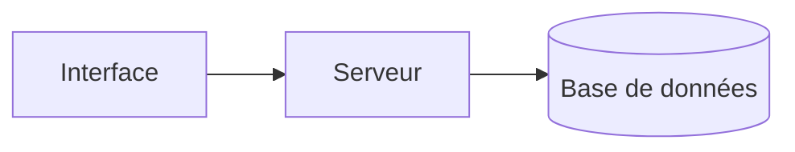

# Architecture

## Modules (étape 14)

| Module | Couche (domaine, application, infrastructure, interface) | Responsabilité : « … et de rien d'autre » |
| --- | --- | --- |
| | | |

## Vues (étape 15)

### Contexte

### Conteneurs

### Domaine

Voir `B-modele.md`.

## Choix techniques (étape 16)

| Sujet | Choix | Décision |
| --- | --- | --- |
| Langage | | D-… |
| Stockage | | D-… |
| Hébergement | | D-… |

À décider : format des erreurs, journalisation, configuration et secrets, migrations, versions d'API, fuseau horaire et devise de référence.

## Squelette marchant (étape 16b)

- Action traversée :
- Environnement de déploiement :
- Hypothèses tranchées : H-…

## Ordre de construction (étape 17)

| Tranche | Fonctionnalités | Scénarios | Règles | Raison de l'ordre |
| --- | --- | --- | --- | --- |
| 1 | | | | |

## Exploitation (étape E2)

- Environnements :
- Déploiement :
- Sauvegardes (dernière restauration testée le …) :
- Retour arrière (dernier essai le …) :
