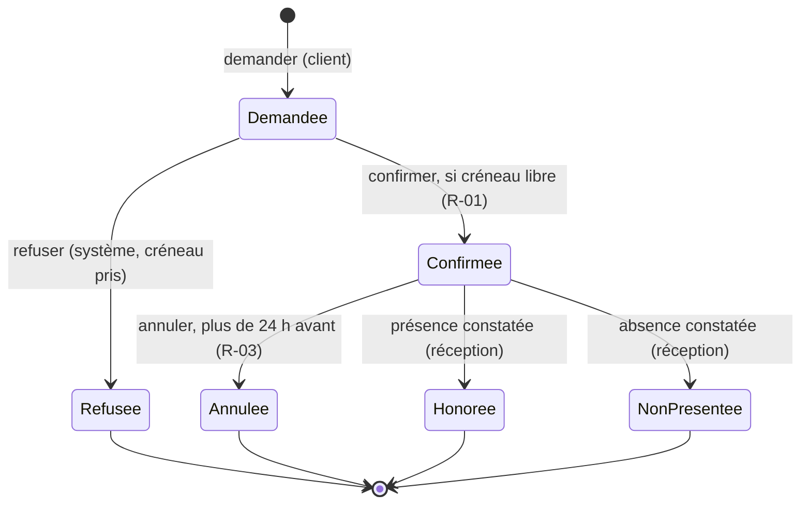

# Étape 9b — Cycle de vie : la machine à états

**Phase :** B · **Livrable :** un diagramme d'états par objet à statut dans `docs/B-modele.md` · **Durée indicative :** 1 heure par objet

## Pourquoi

La question « comment évolue-t-il ? » mérite un outil précis. Sans lui, on finit avec des objets « annulés puis livrés » ou « payés deux fois ». La machine à états est l'outil le plus efficace contre les statuts incohérents.

## Démarche

Pour chaque objet qui a un statut :

1. Lister ses **états**.
2. Dessiner les **transitions permises**, chacune avec :
   - l'événement ou l'action qui la déclenche ;
   - la condition éventuelle (une règle `R-xx`) ;
   - qui a le droit de la déclencher.
3. Identifier les **états finaux**, d'où rien ne sort.

**Règle d'or : toute transition non dessinée est interdite.** On lit la flèche absente autant que la flèche dessinée.

## Exemple : une réservation

Le même outil s'applique à une commande, un ticket d'incident, un dossier administratif, une connexion réseau, un appareil (veille, marche, défaut).

## Version tableau (état × événement)

| État \ Événement | confirmer | annuler | constater présence |
| --- | --- | --- | --- |
| Demandée | → Confirmée | interdit | interdit |
| Confirmée | interdit | → Annulée si R-03 | → Honorée |
| Annulée | interdit | interdit | interdit |

Chaque case « interdit » est un test à écrire.

## Critère de sortie

Chaque objet à statut a son diagramme, chaque transition a son déclencheur et son acteur, et les états finaux sont marqués.
