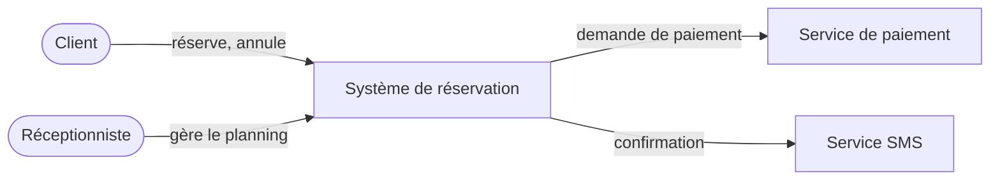

# Étape 15 — Dessiner la carte globale

**Phase :** C · **Livrable :** section « Vues » de `docs/C-architecture.md` · **Durée indicative :** une demi-journée

## Pourquoi

À ce stade, on doit pouvoir voir le système d'un coup d'œil : objets, relations, règles, flux, événements, responsabilités. **Si ce dessin n'est pas clair, le code ne le sera pas non plus.**

## Trois vues standard

Inspirées du modèle C4 (Simon Brown), du plus large au plus précis :

1. **Contexte** : le système au centre, les acteurs humains et les systèmes externes autour, avec ce qu'ils échangent.
2. **Conteneurs** : les blocs qui s'exécutent séparément (application mobile, application web, serveur d'API, base de données, file de messages, micrologiciel) et qui parle à qui, par quel moyen.
3. **Domaine** : objets, relations, cardinalités, agrégats, machines à états (repris de la phase B).

## Exemple de vue de contexte

## Test de clarté

Expliquer le système en 5 minutes à quelqu'un qui ne le connaît pas, avec ces trois dessins seulement. S'il ne peut pas réexpliquer ensuite, les dessins (ou le système) sont trop compliqués.

## Critère de sortie

Les trois vues existent, sont à jour, et ont passé le test de clarté.
